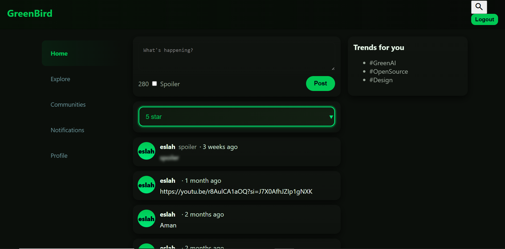
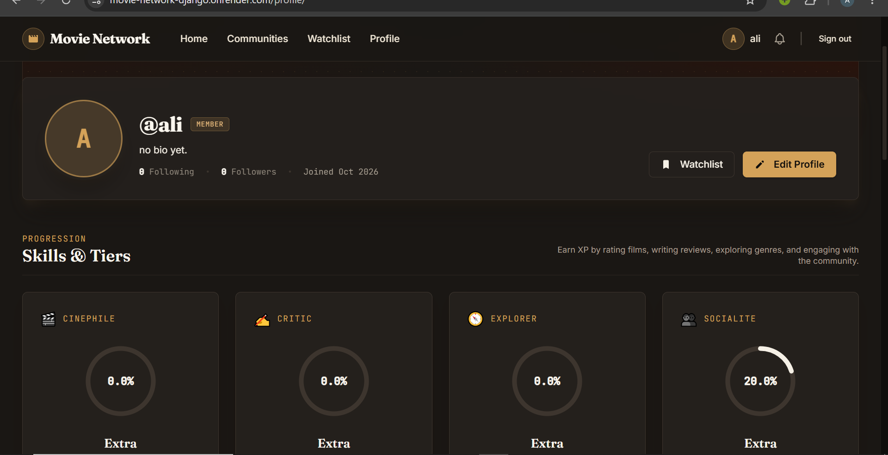

# Movie Network (Django)

A web application built with Django for creating a social platform around movies. Users can search for movies, share their reviews, rate films, and connect with other movie enthusiasts in a networked environment. The project leverages Django's robust framework and offers scalable, modular features that make it easy to extend according to new requirements.

## Features

- User authentication and registration
- Movie search and discovery
- Post, edit, and delete reviews
- Rate and comment on movies
- User profile management
- Follow/unfollow and social networking capabilities
- Responsive frontend (customize for your preferred UI framework)
- Admin interface for content and user moderation

## Technologies Used

- **Backend:** [Django](https://www.djangoproject.com/)
- **Database:** Default is SQLite (configurable to PostgreSQL, MySQL, etc.)
- **Frontend:** HTML5, CSS3, JavaScript (customize for your stack)
- **API:** Django REST Framework (if API support included)

## Setup Instructions

1. **Clone the Repository**

   ```bash
   git clone https://github.com/Al1husse1n/movie-network-django.git
   cd movie-network-django
   ```

2. **Create and Activate Virtual Environment**

   ```bash
   python3 -m venv venv
   source venv/bin/activate
   ```

3. **Install Dependencies**

   ```bash
   pip install -r requirements.txt
   ```

4. **Apply Migrations**

   ```bash
   python manage.py migrate
   ```

5. **Create Superuser (optional for admin access)**

   ```bash
   python manage.py createsuperuser
   ```

6. **Run the Development Server**

   ```bash
   python manage.py runserver
   ```

7. **Access the Application**

   Visit `http://127.0.0.1:8000/` in your browser.

## Contribution

Pull requests are welcome! For major changes, please open an issue first to discuss what you would like to change.

1. Fork the repository
2. Create your feature branch (`git checkout -b feature/AmazingFeature`)
3. Commit your changes (`git commit -am 'Add some AmazingFeature'`)
4. Push to the branch (`git push origin feature/AmazingFeature`)
5. Open a pull request

## License

This project is licensed under the MIT License.  
See the [LICENSE](LICENSE) file for details.

## Acknowledgements

- [Django documentation](https://docs.djangoproject.com/)
- [TMDb API](https://www.themoviedb.org/documentation/api) (if used for movie data)
- Open source contributors

---

_⭐️ Star this repo to support the project!_
## screenshots



